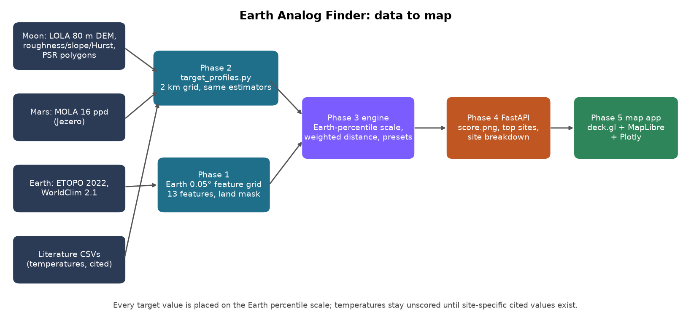
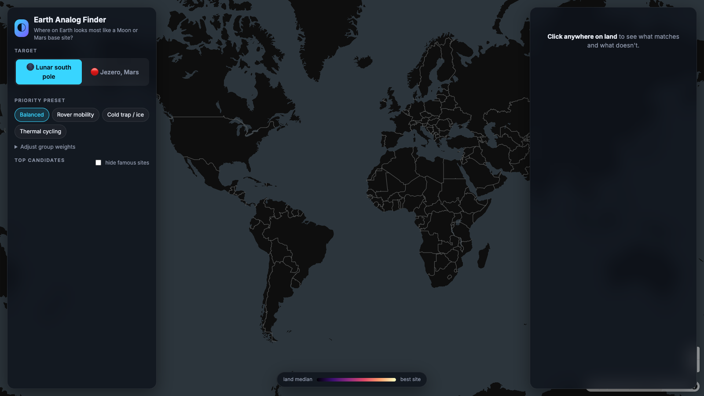

# Earth Analogs of Moon and Mars Base Sites

Rank every place on Earth by how closely it resembles a candidate **lunar south-pole base region** or a **Mars landing site (Jezero)**, explain the match feature by feature, and show where the analogy breaks down.

NASA Space Apps 2026 · *Identify Earth Locations that Analog the Permanent Moon Base Locations and Mars*





> **Status: all 7 phases complete on branch `rahul/data-setup`.** Earth feature grid, target profiles, similarity engine, API, interactive map and site write-up are done. **Open gap:** temperatures are not scored, because no site-specific cited values exist for the lunar south pole or Jezero.

## What this is

A data-driven analog finder, not a "this desert looks like Mars" slideshow. Every Earth land cell (0.05°, ~5 km) gets a vector of physically comparable measurements: relief, slope, roughness at three scales, a scale-robust Hurst exponent, dryness, and an ice/cold proxy. The same features are measured on the Moon and Mars target regions with the same estimators. Each target value is placed on **Earth's own percentile scale**, and every Earth cell is ranked by weighted percentile distance. Every ranking comes with its per-feature breakdown, what is not scored, and what Earth cannot replicate.

## Headline results

| Target | Best overall (balanced) | Why | Source |
|---|---|---|---|
| Jezero (Mars) | Nazca/Ica desert, Peru (-14.9, -75.0), score 98 | relief 428 vs 427 m, slope 1.55° vs 1.52°, ~3 mm/yr | [SITE_ANALYSIS](docs/SITE_ANALYSIS.md) |
| Jezero (Mars) | Eastern Desert, Egypt; Lop Nur region, China | hyper-arid terrain match; wind-carved landscape | same |
| Lunar south pole | Transantarctic region, Antarctica (cold-trap preset), 98 | terrain match plus the coldest air in the grid (-63 °C) | same |
| Lunar south pole | Western Kunlun / Aksai Chin; southern Peruvian Andes | terrain match, but warm: not cold analogs | same |

Validation against Atacama, Dry Valleys, Devon Island, Death Valley and Iceland: all 9 expected-feature checks pass ([validation.md](docs/validation.md)). Place names are approximate; see the limits below.

## Reproduce the results from a fresh clone

Needs Python 3.11 or 3.12 and about 3 GB of disk for the raw data. Commands are for macOS/Linux; on Windows use a venv and `python -m` equivalents.

```bash
git clone https://github.com/Ashokreddy2806/NASA_Space_Challenge.git
cd NASA_Space_Challenge
git checkout rahul/data-setup
python3.11 -m venv .venv && source .venv/bin/activate
python -m pip install -r requirements.txt
```

**1. Raw data** into `../Datasets/{Moon,Mars,Earth}` (not in git). Either fetch the shared copy (private Hugging Face dataset, ask Rahul for access):

```bash
hf download rahuloruganti/nasa-analog-data --repo-type dataset --local-dir ../Datasets
```

or download from the public portals (about 2 GB; sources listed in `docs/DATA_CATALOG.md`):

```bash
python -m backend.pipeline.download T1 T2 --yes
python -m backend.pipeline.download_datasets
```

Set `NASA_DATA_ROOT` to use another folder. The two literature CSVs (`Moon/moon_thermal_literature.csv`, `Mars/mars_thermal_literature.csv`) come with the shared copy; they hold only equatorial/global values, so targets stay unscored for temperature.

**2. Rebuild everything and run all tests (about 6 minutes):**

```bash
make all
```

This runs, in order: `earth_climate`, `earth_terrain`, `build_earth_features` (Phase 1), `target_profiles` (Phase 2), `run_scoring` (Phase 3), then `pytest`. Outputs: `data/processed/*.nc` (git-ignored), `docs/target_profiles.json`, `docs/top_sites.json`, `docs/validation.md`, `docs/figures/*.png`.

**3. Run the app:**

```bash
make serve          # then open http://localhost:8000/   (or /?target=mars_jezero, API docs at /docs)
```

The map app needs internet (CDN libraries and basemap). Endpoint reference: [docs/API.md](docs/API.md).

## Method in five lines

1. Earth: ETOPO 2022 and WorldClim 2.1 on a 0.05° land grid, 13 features ([FEATURES.md](docs/FEATURES.md)).
2. Moon and Mars: the same estimators on a 2 km grid (Moon reprojected from LOLA polar stereographic; Mars from MOLA around Jezero).
3. Normalization: each value becomes its percentile in the area-weighted Earth distribution; targets beyond Earth's range sit at the end of the scale.
4. Score: `100 × (1 − weighted mean |cell percentile − target percentile|)`, with presets (balanced, rover mobility, cold-trap/ice, thermal cycling) and adjustable weights.
5. Output: ranked sites, per-feature sub-scores, mismatches and limits, shown in the map app.

## Repository layout

```
backend/
  pipeline/   downloads, Earth grid (Phase 1), target_profiles.py (Phase 2)
  engine/     similarity.py (Phase 3), run_scoring.py
  api/        FastAPI app (Phase 4); also serves the frontend
  paths.py    data locations (../Datasets, NASA_DATA_ROOT)
frontend/     deck.gl + MapLibre + Plotly map app (Phase 5)
docs/         method, validation, site analysis, submission pack, figures
tests/        one test file per phase
```

## Documentation

- [docs/SUBMISSION.md](docs/SUBMISSION.md): demo-video storyboard, slide outline, judging checklist
- [docs/SITE_ANALYSIS.md](docs/SITE_ANALYSIS.md): top candidates and what they teach us
- [docs/validation.md](docs/validation.md): known-analog validation
- [docs/FEATURES.md](docs/FEATURES.md): feature definitions and normalization
- [docs/API.md](docs/API.md): endpoints
- [docs/DATA_CATALOG.md](docs/DATA_CATALOG.md), [docs/DATASETS.md](docs/DATASETS.md), [docs/data_inventory.md](docs/data_inventory.md): data
- [PLAN.md](PLAN.md), [PROGRESS_LOG.md](PROGRESS_LOG.md), [PROBLEM_STATEMENT.md](PROBLEM_STATEMENT.md): team documents

## Data sources and credits

| Body | Product | Credit / citation |
|---|---|---|
| Moon | LOLA south-polar DEM and derived roughness/slope/Hurst/spectral-slope products (80°S–pole, 80 m and 1 km) | Barker et al. (2023), *Planetary Science Journal* 4, 183, <https://doi.org/10.3847/PSJ/acf3e1>; NASA GSFC PGDA, data DOI <https://doi.org/10.60903/gsfcpgda-lola-spole> |
| Moon | Permanently shadowed regions > 1 km² polygon table | NASA GSFC PGDA LOLA south-polar products (same DOI) |
| Moon | Global context DEM (`ldem_16.tif`) | NASA SVS lunar DEM, 16 pixels/degree |
| Mars | MOLA MEGDR topography, 16 pixels/degree | MGS MOLA, PDS Geosciences Node, <https://doi.org/10.17189/1519460> |
| Earth | WorldClim 2.1 bioclimatic variables, 2.5 arc-minute | Fick & Hijmans (2017), *Int. J. Climatology* 37(12), 4302–4315, <https://doi.org/10.1002/joc.5086> |
| Earth | ETOPO 2022 global relief, 60 arc-second | NOAA NCEI (2022), <https://doi.org/10.25921/fd45-gt74> |
| Moon, Mars | Reference temperatures (equatorial / global, not used as targets) | NASA NSSDC Moon and Mars fact sheets; Sefton-Nash et al. (2019) *Icarus*, <https://doi.org/10.1016/j.icarus.2019.06.002> |
| Map | Basemap tiles | CARTO / OpenStreetMap contributors |

Libraries: deck.gl, MapLibre GL JS, Plotly, FastAPI, rasterio, xarray/netCDF4, scipy, matplotlib.

## Honest limits (carried through every output)

- **Temperatures are not scored.** WorldClim is air temperature (1970–2000), not surface skin temperature, and no site-specific cited lunar-pole or Jezero values exist yet, so warm sites can score 98 for the lunar pole.
- **Scores are percentile ranks.** Many cells score 97–98, so rank order among them is weak evidence; "dry" means dry for Earth, not rainless.
- **Place names are approximate** (identified from coordinates) and "overlooked" means outside our nine-region famous list, not unstudied.
- **Resolution.** Earth cells are ~5 km; the Moon region is 300 km across, Jezero 50 km. Mars 5 km roughness is resolution-limited (weight 0) and its Hurst exponent uses reduced lags.
- **Moon rasters are polar stereographic** and are reprojected, never read as lon/lat.
- **Earth cannot reproduce** reduced gravity, vacuum or the thin Martian atmosphere, or the radiation environment.
