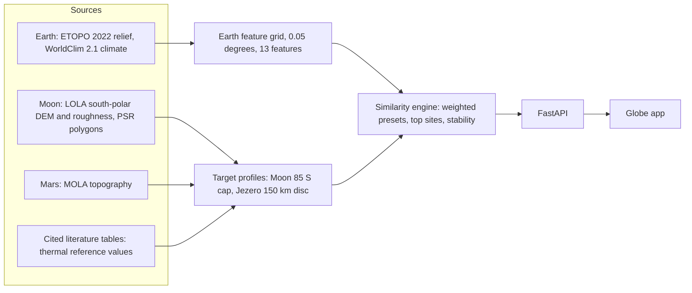

# Analog Earth

**Where on Earth is most like the Moon's south pole, or like Jezero crater on Mars?**

Analog Earth scores all 8.7 million land cells of a 0.05° (about 5 km) global grid against a lunar or Martian target, explains every match feature by feature in real units, and states plainly where the analogy breaks down.

Built for the NASA Space Apps Challenge, *Identify Earth Locations that Analog the Permanent Moon Base Locations and Mars* ([problem statement](PROBLEM_STATEMENT.md)).


## Why

Space agencies test rovers, instruments and crews at a handful of Earth analog sites, mostly chosen by expert judgement. This project asks whether a systematic, whole-planet search agrees with those choices and whether it surfaces places nobody is using.

- **Measured, not "looks like".** The same terrain estimators run on Earth, the Moon and Mars over the same physical window sizes.
- **Whole planet.** Every land cell is scored, not a shortlist of deserts.
- **Beyond the famous sites.** Every ranking is available with the well-known analogs (Atacama, Dry Valleys, Devon Island, ...) removed.
- **Honest.** Each site shows what does not match, what is not scored, and what Earth can never replicate.

## Results at a glance

Scores run from 0 to 1 and are relative to Earth's own land surface. **A Moon score and a Mars score are not comparable**: they use different feature sets (Moon 10 of 13 features, Mars 6 of 13).

| Target | Priority preset | Top site (lat, lon) | Score | What matches | What does not |
|---|---|---|---|---|---|
| Moon south pole | Balanced | -10.28, -77.58 (Peruvian Andes) | 0.80 | relief 1749 m vs 1789 m, Hurst exponent 0.68 vs 0.68, driest month 0.2 mm | 279 mm of rain a year; warm |
| Moon south pole | Rover mobility | -5.93, 146.53 (New Guinea highlands) | 0.86 | relief, slope and roughness | 2400 mm of rain a year, vegetated; terrain only |
| Moon south pole | Cold-trap / ice | -84.33, 175.53 (Transantarctic region) | 0.78 | terrain, cold band, 24 mm precipitation | ice sheet, not regolith (flagged) |
| Mars, Jezero | Balanced | 25.68, 34.58 (Eastern Desert, Egypt) | 0.92 | slope 1.44° vs 1.47°, roughness 35 m vs 40 m, 6 mm of rain a year | no temperature comparison at all |
| Mars, Jezero | Balanced, 2nd | 22.53, 19.03 (southern Libya) | 0.90 | slope 1.34° vs 1.47°, 13 mm of rain a year | relief 322 m vs 472 m |

Place names are our reading of the coordinates, not a gazetteer lookup. Full evidence: [docs/SITE_ANALYSIS.md](docs/SITE_ANALYSIS.md) and [docs/phase3_report.md](docs/phase3_report.md).

How the known analogs score (they were not tuned for): for Jezero, Atacama scores 0.85 (93rd percentile of land) and Rio Tinto 0.82; for the lunar pole, Licancabur scores 0.79 and the Dry Valleys 0.61 (98th percentile), while Devon Island scores only 0.22. We report that rather than hide it.

## How it works



1. **One feature registry.** Relief, slope, roughness at 5, 10 and 20 km, a Hurst exponent (how roughness changes with scale), five temperature statistics and two precipitation statistics. Definitions: [docs/FEATURES.md](docs/FEATURES.md).
2. **Earth grid.** ETOPO 2022 and WorldClim 2.1 are reduced to a 7200 × 3600 grid; every feature is computed in kilometre-sized windows so bodies with different data resolution stay comparable.
3. **Target profiles.** The same registry runs on the lunar cap poleward of 85°S and on a 150 km disc around Jezero. Features the source data cannot resolve are marked unavailable instead of being guessed.
4. **Similarity.** Each feature is compared in real units and by rank on Earth's own distribution, grouped (relief, slope, roughness, multi-scale roughness, temperature, dryness) and combined with preset weights. Unavailable groups are dropped and the weights renormalised. Dryness is a declared physical constraint: the target value is 0 mm.
5. **Sites.** Peaks are separated by at least 50 km, tagged when they fall near a famous analog or inside an ice-sheet region, and given a stability value from nine sensitivity runs.

Every tunable number (grid, windows, targets, weights, presets, famous sites) lives in [`config/`](config/), not in code. See [docs/hardcode_audit.md](docs/hardcode_audit.md).

## Quick start

Requires Python 3.11 and about 3 GB of free disk for the raw data and outputs.

```bash
git clone https://github.com/Ashokreddy2806/NASA_Space_Challenge.git
cd NASA_Space_Challenge
python3 -m venv .venv
source .venv/bin/activate          # Windows: .venv\Scripts\activate
python -m pip install -r requirements.txt
```

**1. Get the raw data** (about 1 GB, no login needed). It goes into `../Datasets/{Moon,Mars,Earth}`, next to the repository; set `NASA_DATA_ROOT` to use another location.

```bash
python -m backend.pipeline.download_datasets
```

Two small hand-made tables of cited thermal values, `Moon/moon_thermal_literature.csv` and `Mars/mars_thermal_literature.csv`, are not downloaded by this script. They live in the team's shared dataset folder; their sources are listed in [docs/DATASETS.md](docs/DATASETS.md).

**2. Build everything** (about 15 minutes on an 8 GB laptop), then run the tests.

```bash
make all
```

**3. Open the app** at <http://localhost:8000/> (interactive API docs at `/docs`).

```bash
make serve
```

Individual steps, if you prefer them one at a time:

| Command | What it does | Time |
|---|---|---|
| `make inventory` | checks every raw file opens and writes `docs/data_inventory.md` | seconds |
| `make climate` | WorldClim to the 0.05° grid plus the land mask | ~1 min |
| `make terrain` | ETOPO to terrain features | ~8 min |
| `make features` | merges, masks, writes figures and `docs/earth_grid_report.md` | ~2 min |
| `make targets` | Moon and Mars target profiles, PSR and Hurst checks | ~4 min |
| `make scores` | score maps, top sites, stability, `docs/phase3_report.md` | ~5 min |
| `make test` | 122 tests | ~40 s |

Without `make`, each target is `python -m <module>`; the module names are in the [Makefile](Makefile).

## Repository layout

```
backend/
  features/     the single feature registry used for Earth, Moon and Mars
  pipeline/     dataset download, inspection, Earth grid build
  targets/      Moon and Mars profiles, PSR verification, thermal tables
  engine/       similarity maths, top-site selection, score builds and reports
  api/          FastAPI application (also serves the frontend)
  config.py     typed loader for config/*.yaml
  paths.py      where raw data and outputs live
config/         every tunable value: grid, features, targets, presets, sites, file names
frontend/       the globe app (MapLibre GL JS, no build step)
docs/           feature definitions, dataset records, generated reports, figures
tests/          one test module per phase
data/           generated outputs (git-ignored)
```

## Data sources and credits

| Body | Product | Credit |
|---|---|---|
| Moon | LOLA south-polar DEM and derived roughness, slope and Hurst products (80°S to pole, 80 m and 1 km) | Barker et al. (2023), *Planetary Science Journal* 4, 183, <https://doi.org/10.3847/PSJ/acf3e1>; NASA GSFC PGDA, <https://doi.org/10.60903/gsfcpgda-lola-spole> |
| Moon | Permanently shadowed regions larger than 1 km² | NASA GSFC PGDA LOLA south-polar products (same DOI) |
| Mars | MOLA MEGDR topography, 16 pixels per degree | MGS MOLA, PDS Geosciences Node, <https://doi.org/10.17189/1519460> |
| Earth | ETOPO 2022 global relief, 60 arc-second | NOAA NCEI (2022), <https://doi.org/10.25921/fd45-gt74> |
| Earth | WorldClim 2.1 bioclimatic variables, 2.5 arc-minute | Fick & Hijmans (2017), *International Journal of Climatology* 37(12), 4302–4315, <https://doi.org/10.1002/joc.5086> |
| Moon, Mars | Thermal reference values | cited literature tables; sources in [docs/DATASETS.md](docs/DATASETS.md) |

The app also loads satellite imagery (Esri World Imagery) and terrain tiles (Mapzen / AWS Terrain Tiles) live in the browser for display only; they are not used in any score.

File-level details: [docs/DATASETS.md](docs/DATASETS.md) and [docs/data_inventory.md](docs/data_inventory.md).

## Limits

- **Earth cannot replicate** reduced gravity (Moon about 1/6 g, Mars 0.38 g), vacuum or the thin Martian atmosphere, or the radiation environment.
- **Temperature is weak evidence.** WorldClim is air temperature (1970 to 2000), not surface temperature. Lunar temperatures enter only as qualitative bands from cited values, at low weight. Mars has no temperature comparison at all, so the Mars ranking is terrain plus dryness.
- **No composition.** There is no mineral, substrate or ice map in this build. A smooth ice sheet and a smooth rock plain look the same to the terrain features; sites inside the Antarctic and Greenland ice-sheet regions carry a flag.
- **Dryness is a bound, not a measurement.** A high dryness score means "almost no rain on Earth", not a measured match to an airless body.
- **Resolution.** MOLA is about 3.7 km per pixel, ETOPO about 1.85 km, lunar products 80 m to 1 km. Features are compared in windows of 5 km and larger; Mars features that MOLA cannot resolve are left out.
- **Scores are Earth-relative.** They rank Earth cells against each other for one target. They are not a probability and not comparable between targets.

## Documentation

Start with the [documentation index](docs/README.md). The most useful pages:

- [docs/FEATURES.md](docs/FEATURES.md): feature definitions and scoring contract
- [docs/SITE_ANALYSIS.md](docs/SITE_ANALYSIS.md): the top candidate sites, with matches and mismatches
- [docs/API.md](docs/API.md): HTTP endpoints
- [frontend/README.md](frontend/README.md): the globe app
- [docs/SUBMISSION.md](docs/SUBMISSION.md): pitch, demo storyboard, slide outline

Team working documents: [PLAN.md](PLAN.md) (approach and decisions log), [PROGRESS_LOG.md](PROGRESS_LOG.md) (who did what), [AGENTS.md](AGENTS.md) (rules for AI assistants working in this repo).

## Team

Rahul, Ashok and Mrinalini, NASA Space Apps Challenge 2026.
