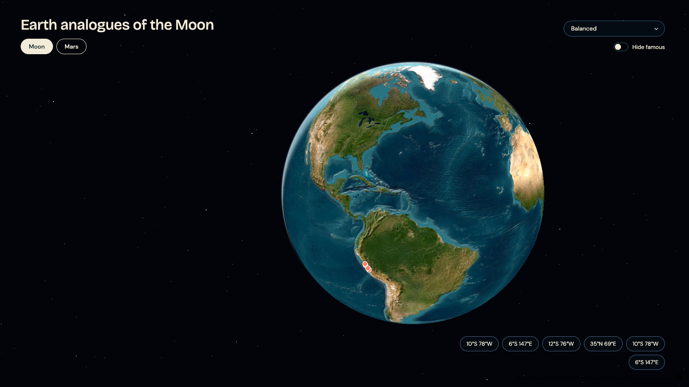

# Frontend

A full-screen globe that shows where Earth resembles the chosen target. Plain HTML, CSS and JavaScript with no build step; the FastAPI backend serves it.

```bash
make serve        # then open http://localhost:8000/
```

It needs the pipeline outputs (`make all`) and an internet connection: the libraries, fonts, satellite imagery and terrain tiles load from public CDNs.



## What you can do

- **Pick a target**: Moon (south pole) or Mars (Jezero).
- **Pick a priority preset**: balanced, rover mobility, cold-trap / ice, or thermal cycling. Presets a target cannot support are not offered.
- **Hide famous sites** to see the candidates that are not already well-known analogs.
- **Read the glow**: the amber overlay marks the highest-scoring land for the current target and preset.
- **Select a site** from the pins or the ranked chips. The side panel shows the overall match, a bar per feature group with the weakest one highlighted, elevation and relief, and what Earth cannot replicate.
- **Compare** opens a radar chart of the site against the target, group by group.

## Files

| File | Role |
|---|---|
| `index.html` | Page shell and controls |
| `js/globe.js` | Map, score overlay, pins, ranked chips, API calls |
| `js/panel.js` | Site detail panel and the comparison chart |
| `style.css`, `panel.css` | Styles for the page and the panel |

## External services

| Service | Used for |
|---|---|
| MapLibre GL JS 5.6 (jsDelivr) | Globe rendering |
| Plotly 2.35 (cdn.plot.ly) | Comparison radar chart, loaded on first use |
| Esri World Imagery | Satellite basemap |
| Mapzen / AWS Terrain Tiles | Hillshade and 3D terrain |
| Google Fonts | Bricolage Grotesque, DM Sans |

Imagery and terrain are for display only. Every score comes from the backend ([docs/API.md](../docs/API.md)).
